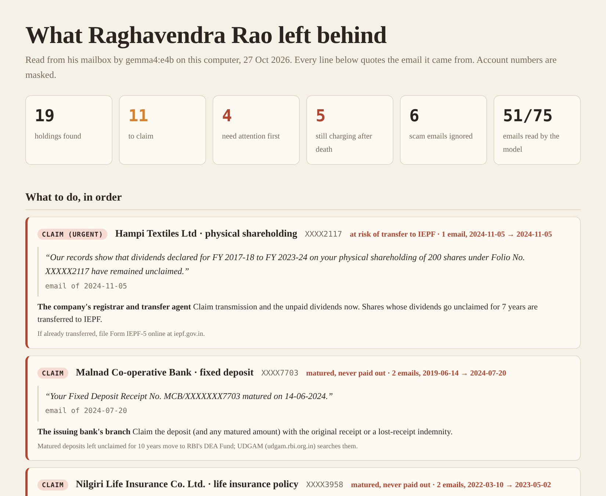

# Ghost Ledger

**When someone dies, their money doesn't tell the family where it is.** Ghost Ledger reads a loved one's mailbox on your own computer with a local Gemma model. It writes down every deposit, policy, folio, pension, loan and subscription it finds, each with the email sentence that proves it. Then it helps you claim them, one phone-approved letter at a time.

**Live site:** [ghostledger.tech](https://ghostledger.tech) · **Example report:** [ghostledger.tech/demo/report.html](https://ghostledger.tech/demo/report.html)



India has about ₹2.2 lakh crore unclaimed across bank deposits, shares, insurance, provident fund and mutual funds (1 Finance, figures as of December 2025, [via Business Today](https://www.businesstoday.in/personal-finance/news/story/rs-22-lakh-crore-unclaimed-funds-lie-idle-across-banks-epf-insurance-stocks-mfs-524958-2026-04-10)). Unreported deaths and heirs who don't know about older investments are among the causes it lists. Usually, the only complete record of what someone owned is their inbox.

## How it works

| Step | What happens | Built with |
|---|---|---|
| 1. Load | A folder of `.eml` files or a Google Takeout `.mbox`. A cheap filter keeps mail about accounts and money. Code-level checks set aside scams, which never reach the model. | Python |
| 2. Read | Gemma lists what each email shows the person held, owed or paid for, with the exact sentence, in a fixed JSON schema. | **Gemma 4 E4B** via Ollama, on a laptop CPU |
| 3. Check | Plain code verifies that each quote is in the email, the institution is named and the account number appears. Failures get one retry, then they're dropped. | `grounding.py` |
| 4. Map | Holdings are merged across emails, numbers masked, and each one gets the official route (UDGAM, IEPF-5, AMC transmission, EPFO Form 20…). | `ledger.py`, `routes.py` |
| 5. Claim | One workflow per claim: draft the letter, wait for approval on the executor's phone, send from her Gmail, wait 15 days, remind twice, then draft the regulator complaint. | **Temporal**, **Auth0** (Token Vault + CIBA/Guardian) |

## Results

Both mailboxes are invented, each with a written answer key in `data/estate*/truth.yaml`. Both readers get the same filters and checks. The second estate was [committed before any model read it](https://github.com/samarthkumble/ghost-ledger/commit/d31d2ac).

| | Raghavendra, 75 emails | | Leela, 47 emails (held out) | |
|---|---|---|---|---|
| | regex | Gemma | regex | Gemma |
| Holdings and debts found | 11/15 | **15/15** | 7/13 | **13/13** |
| Subscriptions and bills found | 3/5 | **5/5** | 1/4 | **4/4** |
| Matured / at-risk / dormant / closed caught | 4/5 | **5/5** | 2/4 | **4/4** |
| Invented entries | 0 | 0 | 1 | 1 |
| Filed as the wrong kind | 3 | 0 | 4 | 0 |
| Closed account claimed / scam emails used | 0 / 0 | 0 / 0 | 0 / 0 | 0 / 0 |

Gemma 4 E4B ran on a Ryzen 5 5500U CPU at a median of about 20 s per email. The first Raghavendra run had one invented entry, one wrong kind and one missed "matured" flag. All three came from the checking code and were fixed there; that run's results are kept in `data/estate/gemma-run1-results.json`. Gemma's one held-out mistake: a metro trip receipt became a utility bill. Full results are in `eval/`.

## Run it

```bash
ollama pull gemma4:e4b
pip install -r requirements.txt
python -m ghostledger doctor
python -m ghostledger scan data/estate/mails        # out/report.html, out/ledger.json, out/letters/
python -m ghostledger eval                          # Gemma vs regex on the synthetic estate
python -m pytest -q                                 # 20 tests, no model needed
```

Durable claims (Temporal + Auth0 + Gmail). The full setup is in [docs/SETUP.md](docs/SETUP.md):

```bash
temporal server start-dev --db-filename temporal.db   # window 1
python -m ghostledger worker                          # window 2
python -m ghostledger login                           # executor signs in (Auth0)
python -m ghostledger connect-gmail                   # Gmail into Auth0 Token Vault
python -m ghostledger claim 2 3                       # open claim workflows
python -m ghostledger board --watch                   # watch them
```

No accounts? Set `GHOST_APPROVER=console` and `GHOST_SENDER=outbox`, and approve claims from the command line. Letters are written to `out/outbox/`.

## Privacy and safety

- The mailbox never leaves the computer. Gemma runs locally, and the cache, outputs, `.env` and tokens are all git-ignored.
- No Google token is stored. Auth0 Token Vault holds it, and Ghost Ledger exchanges for a short-lived Gmail token only when a letter is sent.
- Nothing is sent without the executor approving that exact letter on her phone.
- Claim letters are fixed templates filled from verified fields; the model doesn't write them.
- Claim routes are general guidance from public sources (RBI, SEBI, AMFI, IEPF, EPFO, insurers), **not legal advice**.

## Layout

```
ghostledger/   gemma.py (reader) · grounding.py (checks) · ledger.py · routes.py · letters.py · report.py
               flows.py + activities.py (Temporal) · auth0.py + gmail.py · evaluate.py · baseline.py
data/          estate/ (Raghavendra) · estate2/ (Leela, held out): mails + truth.yaml
scripts/       make_estate.py · make_estate2.py · build_site.py
site/          ghostledger.tech source
tests/         core checks and workflow logic (fake model, fake Temporal)
```

MIT licensed. Built for the DEV Hacktoberfest Open-Source AI Challenge, "Ghost in the Machine".
